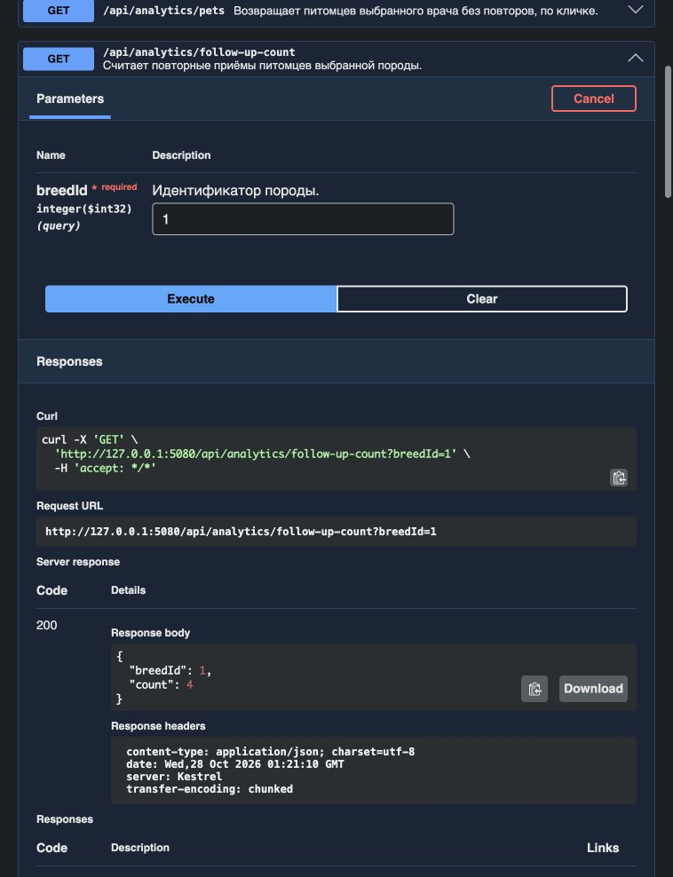

# Лабораторная 3 - Ветеринарная клиника

**Мась Андрей Алексеевич, группа 6411-100503D, вариант 12.**

REST API на ASP.NET Core для владельцев, питомцев, пород, ветеринаров, специализаций и приёмов. Данные хранятся в PostgreSQL. При первом запуске EF Core создаёт таблицы и заполняет их начальными данными.

## Запуск

Понадобятся .NET SDK 10.0 и работающий Docker. При первом запуске установите компоненты Aspire, затем запустите приложение из корня репозитория:

```sh
dnx --yes aspire.cli@13.5.4 -- --nologo setup
dotnet run --project src/VeterinaryClinic.AppHost -e ASPIRE_NON_INTERACTIVE=true
```

Aspire запускает PostgreSQL и API. Локальный профиль использует HTTP, поэтому доверять сертификату разработки не требуется. Откройте панель по ссылке из терминала, перейдите по адресу ресурса `api` и добавьте `/swagger` для Swagger UI или `/openapi/v1.json` для OpenAPI. База `clinic` хранится в томе Docker и сохраняется после остановки приложения.

Для запуска без базы можно выбрать хранилище из второй работы:

```sh
dotnet run --project src/VeterinaryClinic.Api -- --Storage:Provider=InMemory
```



## Структура

- `VeterinaryClinic.Domain` - доменные классы, начальные данные и интерфейсы репозиториев.
- `VeterinaryClinic.Shared` - перечисление видов животных.
- `VeterinaryClinic.Contracts` - модели запросов и ответов, сгруппированные по сущностям.
- `VeterinaryClinic.Application` - службы и преобразование в DTO.
- `VeterinaryClinic.Infrastructure.PostgreSQL` - контекст EF Core, репозитории и миграции схемы и данных.
- `VeterinaryClinic.Infrastructure.InMemory` - репозитории в памяти.
- `VeterinaryClinic.AppHost` и `VeterinaryClinic.ServiceDefaults` - запуск через Aspire, телеметрия и проверка готовности API.
- `VeterinaryClinic.Api` - контроллеры, обработка ошибок и документация.

Контроллеры передают запросы службам, службы проверяют данные и обращаются к репозиториям. Работа контроллеров и служб журналируется.

## Запросы API

Для `/api/owners`, `/api/pets`, `/api/breeds`, `/api/veterinarians`, `/api/specializations` и `/api/appointments` доступны:

- `GET /api/{resource}` - список; `GET /api/{resource}/{id}` - одна запись.
- `POST /api/{resource}` - создание, ответ `201` и адрес записи в `Location`.
- `PUT /api/{resource}/{id}` - изменение, ответ `204`.
- `DELETE /api/{resource}/{id}` - удаление, ответ `204`, в том числе при повторном вызове.

Идентификатор назначает сервер. Некорректные данные дают `400`, отсутствующая запись или ссылка - `404`, удаление используемой записи - `409`. Если кабинет уже занят на это время или возник конфликт одновременных изменений, API возвращает `409`. При записи и поиске номер кабинета может содержать до 20 символов без учёта пробелов по краям. Неудачное изменение сохраняет прежние данные.

Связанные записи доступны отдельными маршрутами, например `/api/owners/1/pets`, `/api/pets/1/appointments`, `/api/veterinarians/1/specialization`. Полный список есть в Swagger.

| Аналитика | Пример GET-запроса |
| --- | --- |
| Врачи по виду животного | `/api/analytics/veterinarians?species=Cat` |
| Питомцы врача, по кличке | `/api/analytics/pets?veterinarianId=1` |
| Число повторных приёмов породы | `/api/analytics/follow-up-count?breedId=1` |
| Владельцы нескольких питомцев с их количеством (`petCount`), по ФИО | `/api/analytics/owners-with-multiple-pets` |
| Приёмы кабинета за месяц от выбранной даты | `/api/analytics/appointments?asOfDate=2026-09-15&roomNumber=101А` |

Даты приёмов фиксированы. Интервал начинается с выбранной даты включительно и заканчивается через месяц, не включая конечную дату. Например, с 15 сентября до 15 октября; с 31 января до 28 или 29 февраля. Время приёма местное, без смещения UTC. В базе оно хранится с точностью до микросекунд; в запросе указывайте не более шести знаков после точки.

Начальный набор содержит 10 пород, 10 владельцев, 13 питомцев, 10 специализаций, 10 врачей и 17 приёмов. Все персональные данные вымышлены.

## Тесты

```sh
dotnet test --solution VeterinaryClinic.slnx --configuration Release
```

Тесты первой работы проверяют запросы к исходным данным. HTTP-тесты работают с отдельным хранилищем в памяти. Для интеграционных тестов Aspire запускает API и отдельный контейнер PostgreSQL. Тесты проверяют ответы API и читают сохранённые записи напрямую из базы.
